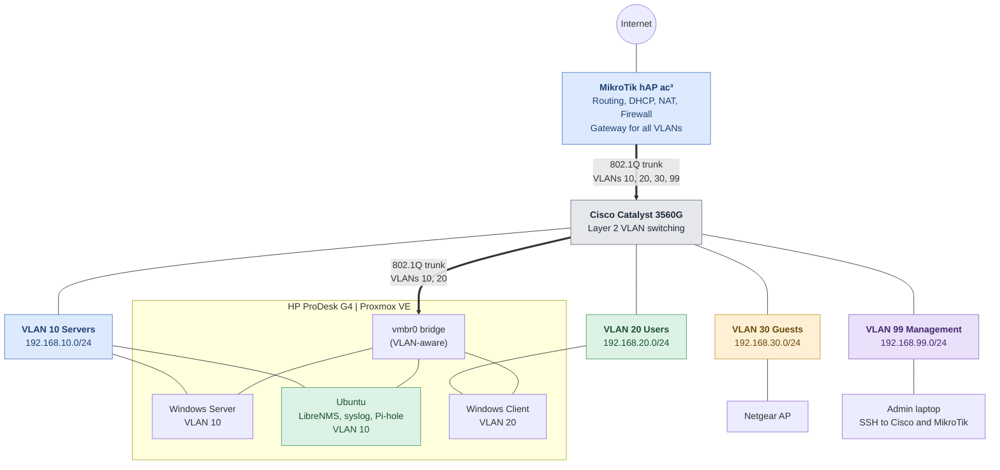

# Fredrick Kimutai | Aspiring Network Engineer

**Final-year Computing & IT student at CCT College Dublin, building and documenting real network labs.**
AWS Certified Cloud Practitioner | CCNA in progress | Dublin, Ireland

I design, cable, configure and break networks on real hardware, then document how I fixed them. My home lab runs on a **MikroTik hAP ac³**, a **Cisco Catalyst 3560G** and an **HP ProDesk G4 running Proxmox VE**, alongside Packet Tracer and EVE-NG for larger topologies.

> Looking for **Network Technician**, **Data Centre Technician**, **Infrastructure** and **IT Support** internships and associate roles in Ireland.

## 🧭 My Lab Network

This is the network running in my home lab right now. The MikroTik routes for every VLAN, the Catalyst switches them over one 802.1Q trunk. A second trunk carries VLANs 10 and 20 to Proxmox, which hosts the servers, the client and the monitoring and DNS services on Ubuntu. My admin laptop sits on the management VLAN. The core architecture is built and running, and I am now working on monitoring and alerting across it.

## 🎯 Current Focus

- Preparing for the **Cisco CCNA 200-301**
- Switching, routing, VLANs, OSPF and network security labs
- Monitoring the lab with LibreNMS and syslog: device health, interface traffic and alerting
- Windows Server, Active Directory and PowerShell
- Tuning DNS filtering and logging on Pi-hole

## ⭐ Featured Projects

| Project | What it covers | Status |
|---|---|---|
| [Inter-VLAN Routing](https://github.com/kkfred202/ccna-networking-labs/tree/main/inter-vlan-routing) | VLANs, trunking and routing between VLANs | Completed |
| Physical Networking Homelab | MikroTik hAP ac³ and Catalyst 3560G with server, user, guest and management VLANs, DHCP, routing, NAT | Completed |
| Proxmox Server Infrastructure | HP ProDesk G4 hosting Windows Server, a Windows client and Ubuntu on a VLAN-aware bridge, with Pi-hole, LibreNMS and syslog | Completed |
| Lab Monitoring | LibreNMS and syslog across the router, switch and VMs | In progress |
| [CCNA Networking Labs](https://github.com/kkfred202/ccna-networking-labs) | Topic labs that follow the CCNA syllabus | In progress |

## 🗺️ Up Next

- Windows Server: Active Directory, DHCP and Group Policy
- Campus LAN with redundant switching (LACP, Rapid PVST+, HSRP)
- Three-site OSPF WAN
- Wireshark troubleshooting pack

More planned labs

- Device hardening and ACL policy (SSH, ACLs, SNMPv3)
- Redundant DHCP and DNS services
- Network automation with Python, Netmiko and Ansible
- Wireless WLAN build
- Linux server administration and hardening
- Structured cabling and data centre rack design
- WireGuard VPN and VM backup and recovery

## 🧰 Skills and Tools

**Networking:** TCP/IP, subnetting, VLANs, 802.1Q trunking, inter-VLAN routing, NAT, DHCP, Cisco IOS, MikroTik RouterOS, structured cabling

**Systems:** Proxmox VE, Windows Server, Linux CLI, virtual machines, BIOS/UEFI configuration

**Tools:** Cisco Packet Tracer, EVE-NG, VirtualBox, VMware, Hyper-V, Git, AWS

## 🎓 Certifications

| Certification | Status |
|---|---|
| AWS Certified Cloud Practitioner | Achieved |
| Cisco CCNA 200-301 | In progress |

## 🤝 Connect With Me

[LinkedIn](https://www.linkedin.com/in/kimutai-fredrick/)
